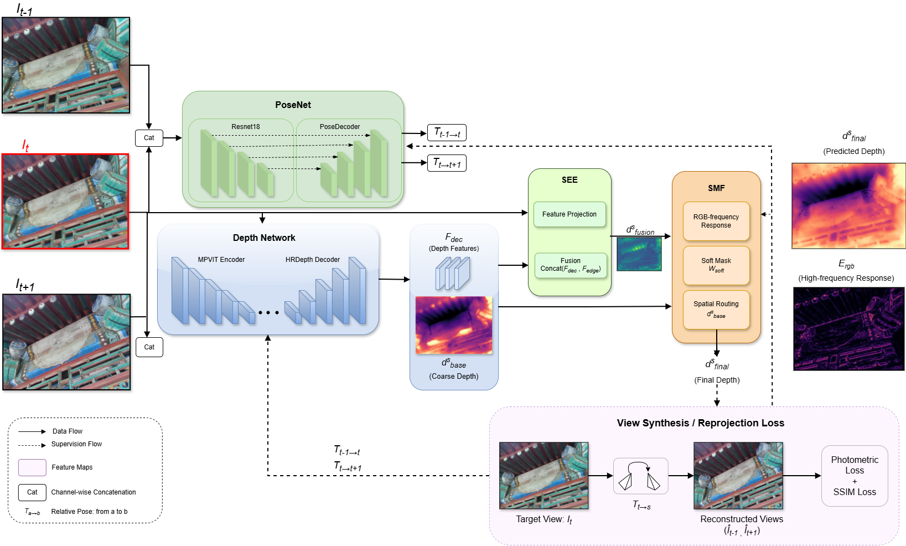
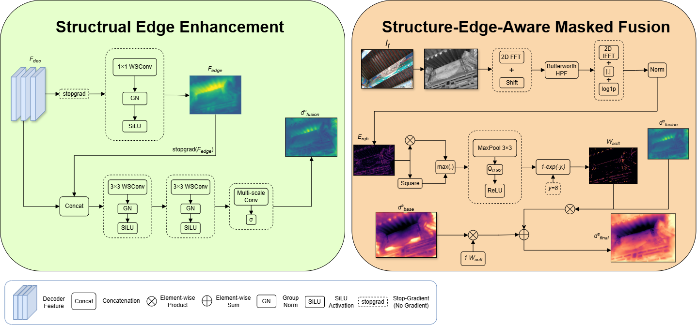
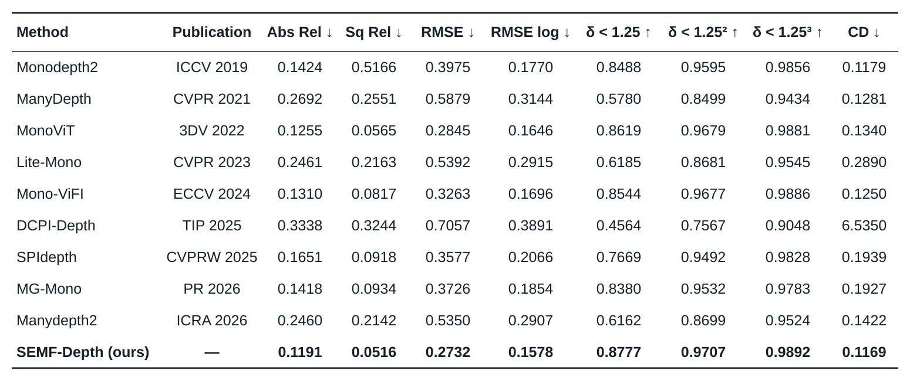
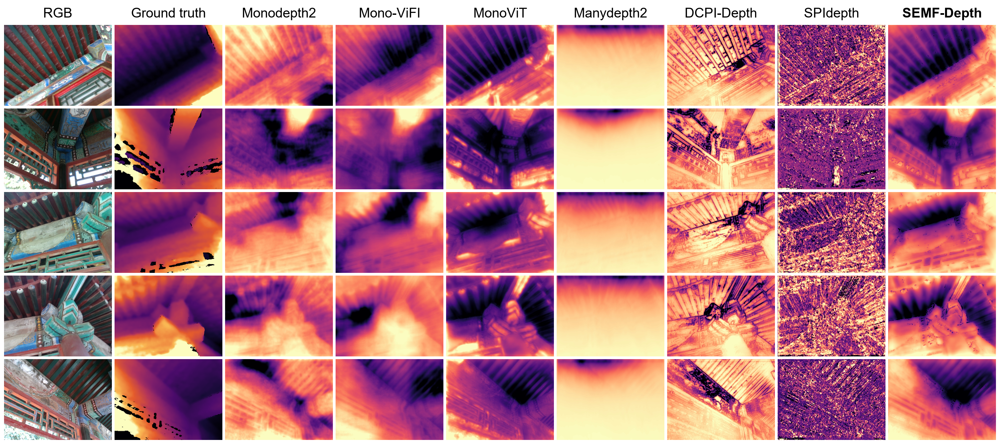
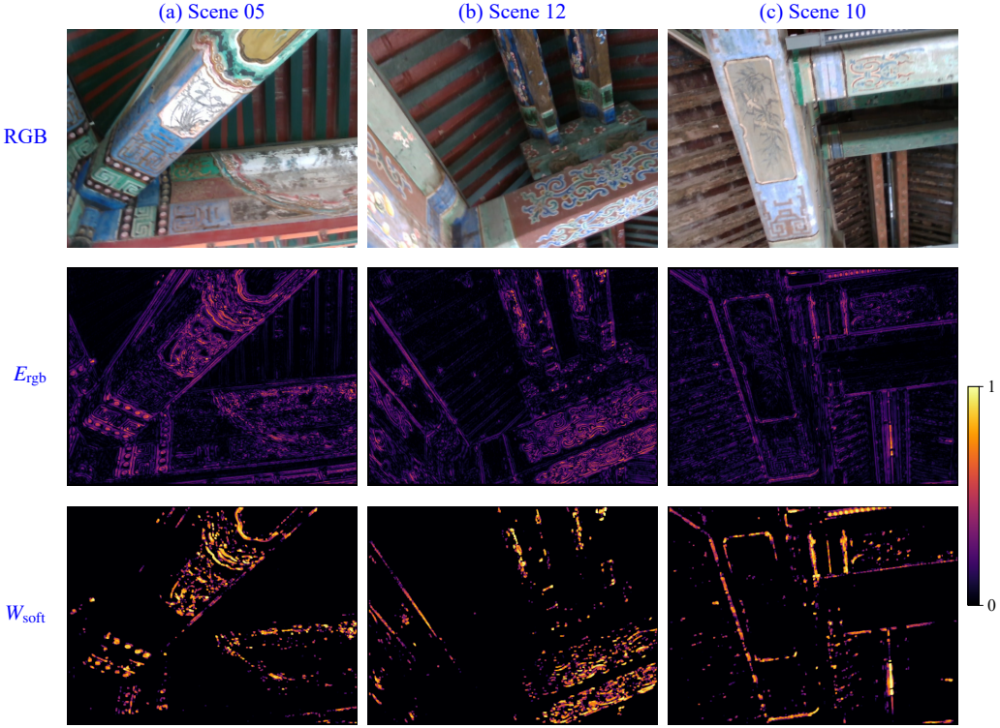

<h1 align="center">SEMF-Depth</h1>

<p align="center">Texture-Structure Decoupled Monocular Depth Estimation in Complex 3D Reconstruction Scenes</p>
<p align="center">Jianfei Teng · Xiaoling Yao · Lihua Hu · Yang Ma · Jifu Zhang</p>

Official PyTorch implementation of SEMF-Depth. Structural Edge Enhancement (SEE)
fuses projected features with decoder features to produce an auxiliary depth
prediction. Structure-Edge-Aware Masked Fusion (SMF) combines the backbone and
auxiliary predictions using soft masks derived from RGB-frequency responses.




## Installation

```bash
git clone https://github.com/Jianfei-Teng/SEMF-Depth.git
cd SEMF-Depth
pip install torch==2.9.1 torchvision==0.24.1 --index-url https://download.pytorch.org/whl/cu130
pip install -r requirements.txt
```

The server experiments used Python 3.10+, PyTorch 2.9.1 and one RTX 5090 GPU.

## Data and pretrained backbone

- [Dataset](https://pan.baidu.com/s/1l_t3OPJbO8HLGn69DmINTQ?pwd=6pjw): extract to `./ancient_architecture_data`.
- [Pretrained backbone](https://pan.baidu.com/s/1jd117vwJB9Smicr0sgiU3g?pwd=i3ng): extract to `./weights`.

Training and evaluation splits and camera intrinsics are provided in `splits/`.

## Training

```bash
python train.py --stage auto --backbone_weights ./weights --split_dir ./splits/ancient
```

Training uses 50 backbone epochs followed by 20 refinement epochs. The default
settings are `s=0.08`, `gamma=8` and seed `1234`; see
[experiment_config.json](experiment_config.json) for the training configuration.
Add `--resume` to continue an interrupted run.

## Evaluation and visualization

```bash
python evaluate_metrics.py --weights ./tmp/SEMF/refinement/models/weights_69 --output-dir ./results/SEMF
python visualization.py --weights ./tmp/SEMF/refinement/models/weights_69 --input ./ancient_architecture_data/test --output-dir ./results/visualization
```

Evaluation uses per-image median scaling and the Garg crop. Visualization exports
depth, RGB-frequency responses, soft masks and projected-feature maps.

## Results





## Acknowledgements and license

Based on [MonoViT](https://github.com/zxcqlf/MonoViT),
[Monodepth2](https://github.com/nianticlabs/monodepth2),
[MPViT](https://github.com/youngwanLEE/MPViT) and
[HR-Depth](https://github.com/shawLyu/HR-Depth).
See [LICENSE](LICENSE) and [LICENSES](LICENSES) for the original and third-party terms.
